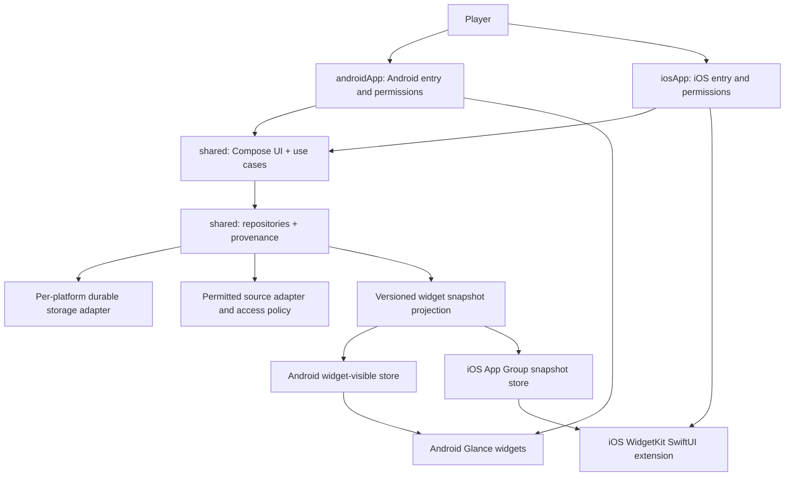

# Apex Companion — technical architecture

**State:** v0.1 Maps, v0.2 Ranked/Profile and v0.3 private history/session/backup architecture implemented for private developer use; public provider access remains gated. **Adopted:** 2026-11-02, updated for Android + iOS with Kotlin Multiplatform and scope removal. Accepted decisions are in [ADR register](ADR.md).

**Milestone verification policy (owner decision, 2026-11-02):** Android and Linux-compatible shared checks are required during intermediate versions. Continue implementing iOS source, marked `Implemented — Not Verified`; do not attempt iOS builds, tests, simulators or Apple tooling until final stabilization/release preparation. Deferred iOS verification alone does not block intermediate completion. Unimplemented functionality is `Planned`; unavailable implementation dependencies are `Blocked`. See [ADR 0007](adr/0007-intermediate-platform-validation.md).

## 1. Architectural thesis

Build a **single Kotlin Multiplatform product with two native mobile app entry points**, where domain policy, schedule calculations, RP math, state provenance, snapshot projection and the main Compose Multiplatform interface are shared. Android and iOS have different home-screen widget runtimes; implement them natively and feed them the **same validated, versioned app-owned data projection**. The live API is optional and release-gated. Prefer a meaningful offline demo + Ranked calculator before network integration.

| Layer | Selection | Reason / constraint |
|---|---|---|
| App creation | KMP Wizard, Android + iOS, shared Compose UI | Existing generated Gradle/Xcode structure is authoritative; do not recreate it |
| Core | `shared/src/commonMain` Kotlin + Compose Multiplatform | Same UI, validation, state and calculations on both OSes |
| Android app | `androidApp/`, Compose host, Glance | Android-specific launcher integrations, permissions and WorkManager |
| iOS app | `iosApp/`, Swift/UIKit Compose host, WidgetKit/SwiftUI extension | Xcode signing, App Group shared snapshot, iOS timeline and native configuration |
| Storage | KMP-compatible repository with tested Android/iOS persistence adapters; assess Room KMP, DataStore KMP or platform SQL before adopting | Avoid assuming Android-only database APIs work on iOS; adapters and migration tests mandatory |
| Network (v0.1) | Ktor common client with Android/iOS engines, Kotlinx Serialization | Avoid Android-only HTTP dependencies in shared code; mock responses without real keys |
| Background | Android WorkManager; iOS OS-permitted refresh + WidgetKit timelines | iOS background fetch/timeline is not exact; no infinite poll loops |
| OCR (v0.4) | Native picker per OS and vetted on-device OCR adapter | Privacy, licenses and platform-specific quality tests |
| Release | GitHub APK after signing; iOS TestFlight/App Store or source-built Xcode app depending on Apple account/review | A GitHub IPA file alone is not a generally installable iOS distribution |

Do **not** pin framework versions in docs without checking actual Wizard project metadata, compilation and availability for both platforms. Actual Wizard Android minSdk is 24; iOS deployment target is 18.2 (source configuration, unverified). Library claims are design candidates, not confirmed compatibility reports.

## 2. KMP and system boundaries



No widget reads raw HTTP data or reaches directly into shared UI state. App code validates and persists a compact snapshot; the platform widget reads this immutable data. Sync is deduplicated by endpoint and identity rather than multiplied by widget instances. Widgets indicate `DEMO/STALE/UNAVAILABLE` even when the app is absent or a time boundary has passed.

## 3. Project layout and ownership

**Actual Wizard-generated paths win over samples below.** For the current common shared-UI Wizard layout:

```text
androidApp/                                  Android entry, Glance, WorkManager
iosApp/                                      Xcode app target, native WidgetKit extension (source implemented, unverified)
shared/src/commonMain/kotlin/.../            Domain, use cases, repositories/interfaces, shared Compose UI
shared/src/commonTest/kotlin/.../            Platform-neutral deterministic tests
shared/src/androidMain/kotlin/.../           Android-specific implementations when needed
shared/src/iosMain/kotlin/.../               iOS-specific implementations when needed
```

If Wizard chooses `sharedLogic` + `sharedUI` instead of `shared`, review and document the actual modules; **never rewrite an existing generated project to satisfy this textual example**. [KMP setup](KMP_SETUP.md) gives the safe overlay instructions.

### Suggested logical namespaces (not pre-created source files)

```text
shared/commonMain/
  core/model/                   IDs, envelope, source errors, modes, time
  core/repository/              Stable domain repository interfaces
  core/backup/                  JSON schema and validation contracts
  feature/maps/                Normalized schedules, rotation, fresh/expired states
  feature/ranked/              Goal math, profiles, snapshots, observation intervals
  feature/settings/            Preferences contracts
  ui/                          Shared Compose screens + navigation + design system
androidApp/
  widget/                      Glance maps and ranked goal
  platform/                    WorkManager, pickers, widget-visible persisted projection
iosApp/
  WidgetExtension/             WidgetKit/SwiftUI, Intent/App Intent configuration
  platform/                    iOS pickers, App Group snapshot writer and reload bridge
```

The `iosApp/WidgetExtension` source and registered Xcode target are now present. They have not been compiled or run.

## 4. Domain contracts

`MapScheduleRepository`: `Flow<MapScheduleState>`, normalized `MapSegment` time bounds, `current?`, `next?`, `source`, `retrievedAt`, `validUntil`, `mode`; empty next is valid. `RankedRepository`: read optionally linked identity by platform+UID, manual override/goal fallback and timestamped observations. `SessionRepository`: explicit user boundaries and interval links. `WidgetProjectionService`: builds `WidgetSnapshot` records suitable for both native widget systems. `BackupRepository`: exports and atomically imports allowlisted user records. Only define concrete interfaces when needed by an approved implementation milestone.

```kotlin
interface MapScheduleRepository {
    fun observe(mode: GameMode): Flow<MapScheduleState>
    suspend fun refresh(mode: GameMode, cause: RefreshCause): RefreshOutcome
}
interface RankedRepository {
    fun observeProfile(identity: PlayerIdentity): Flow<RankedProfileState>
    suspend fun requestRefresh(identity: PlayerIdentity): RefreshOutcome
}
interface WidgetProjectionService {
    suspend fun snapshot(kind: WidgetKind, config: WidgetConfig): WidgetSnapshot
}
```

Pure models must not depend on `android.*`, `SwiftUI`, `WidgetKit`, Android Room entities, platform handles, or raw provider JSON. Platform adapters may depend on those types. When a platform capability differs, expose a capability/state rather than pretending parity.

## 5. Source, time and validity rules

- `DataEnvelope<T>` holds optional value, state (`LIVE`, `STALE`, `UNAVAILABLE`, `DEMO`, `MANUAL`), source ID, retrievedAtUtc, optional upstream-valid-until, last safe error and schema version. Null is not zero.
- Store absolute timestamps as UTC values and format only for display. Use monotonic time for in-process intervals if needed.
- A cached segment may become active locally only if the validated schedule explicitly covers the current time. This is *cached schedule inference*, never a new upstream observation.
- DEMO data must always carry a DEMO label in the app and both widget systems.
- No seconds-perfect countdown promised on Android Glance or iOS WidgetKit. Prefer `Ends at 22:45`; iOS timelines may describe future transitions but have OS-controlled reload budgets.
- Do not synthesize map cycles from old screenshots or assume a fixed season map pool.

## 6. Ranked semantics

Two compatible observations `(t0,rp0)` and `(t1,rp1)` within the *same verified player, mode, season and split* define an observed interval delta `rp1-rp0`. They do not prove the count of matches, placement, damage or kills. Unknown seasons/split identity, stale or out-of-order observations require explicit quality flags and may block delta computation. Crossing rank reset starts a new baseline. A manual session groups observations but does not assert individual match boundaries. Only user-confirmed or authorized-source match records enable per-match analytics. Detailed rules: [RANKED_TRACKING.md](RANKED_TRACKING.md).

Goal math uses integer RP and positive remaining days, computes `remaining=max(0,target-current)`, `daily=ceil(remaining/days)` when days > 0; after the deadline, show an expired state rather than division by zero. This must be byte-for-byte semantically identical in shared KMP tests on both platforms.

## 7. Local storage, restore and widget projection

The local store must persist user goals, chosen mode, map cache, optional profiles and observations, per-widget user preferences and `ImportBatch` for idempotent backups. Schema changes require migrations and fixture tests on **both** platforms. Do not couple the shared domain to a particular database driver.

- Android: widget-visible projection is committed durably, then Glance instances are notified; platform storage method selected during bootstrap.
- iOS: app writes a **small versioned sanitized JSON or key-value snapshot** atomically in an App Group container shared with a signed WidgetKit extension. The extension reads only that projection, not the Kotlin database; `WidgetCenter` requests reloads, with the OS free to defer them. Widget configuration/entitlements/signing are checked in Xcode.
- System widget instance IDs and per-device paths are **not** portable backup data. Export user preferences/presets only and allow each OS to recreate widget instances.
- Export includes version and allowlisted records; never provider tokens, raw screenshot bytes, App Group paths or stale credential settings. Validate to staging and atomically apply; malformed import leaves existing data unchanged.

See [WIDGETS.md](WIDGETS.md), [IOS_WIDGETS.md](IOS_WIDGETS.md), [DATA_MODEL.md](DATA_MODEL.md).

## 8. API policy, security and privacy

Public live features stay disabled unless the provider explicitly allows redistribution, a sustainable access topology is agreed and privacy/attribution controls are tested. A successful developer request does not imply public distribution rights. An APK or IPA can be reverse engineered; neither platform may ship a shared upstream credential. See [API_INTEGRATION.md](API_INTEGRATION.md) and [SECURITY_PRIVACY.md](SECURITY_PRIVACY.md).

## 9. Validation and delivery

- Validate shared calculations and source-state logic with KMP `commonTest` and actual Android/iOS target tasks when possible.
- Run Android debug build, UI/Glance and Linux-compatible shared tests now. Defer all iOS compilation/tests/tools to final stabilization under ADR 0007.
- Record environment and tests **actually executed**. Linux does not establish iOS build/extension success.
- Release gates are per platform: Android signed APK and checksums; iOS proper signing, distribution entitlements, App Store/TestFlight rules and any Apple account requirement. Never promise free sideloading on iOS.

## 10. Architectural recommendation

**Build first:** KMP Wizard Android+iOS shared UI, offline goal math and DEMO map on both platforms, then one native map widget and one native goal widget per platform, plus safe local persistence. **Largest risk:** obtaining authorized sustainable online data and validating Apple widget signing/timelines. **Avoid:** Android-only architecture disguised as KMP, unverified data shown as live, or a hidden shared API key.

## v0.1 concrete implementation

`shared/maps` owns normalized schedules, typed parser records, repository StateFlow, per-playlist observation times, persisted failures and KMP widget timelines. `shared/network` implements bounded streaming Ktor transport with explicit authorized access routes; public release and iOS hosts use the unconfigured provider; Android debug alone supports an explicitly provisioned private runtime credential, excluded from backups and binaries. Android uses an AtomicFile normalized repository record and per-instance Glance preferences; iOS source uses private atomic Foundation cache plus separate sanitized App Group projection. JSON tree parsing avoids introducing a compiler plugin; records are manually validated before domain construction. No database migration/library was needed for this small versioned schedule cache. Android compile/tests establish only Android compatibility of these library selections.

## v0.2 concrete implementation

`shared/ranked` owns nullable provider identity/rank/RP, current-state-only repositories, immutable goals and local-calendar deterministic arithmetic. Manual RP/source preferences and goals remain independent of linked identity; disconnection removes private snapshot data. Separate normalized ranked and global Predator record codecs reuse the existing AtomicFile/Foundation adapters; map storage is untouched. `ProviderRequestBudget` spans map/profile/Predator within the app process, with repository-backed endpoint cooldown/backoff restored at startup. The existing unique WorkManager handles all configured provider work and local widget boundaries.

The shared Compose app adds Ranked, Profile and minimum source/privacy/date settings alongside Maps. Three Glance widgets consume shared sanitized projections. The existing iOS App Group bridge/extension gains matching source, marked Implemented — Not Verified. No new persistence library, endpoint scheduler, private history, public credential route or backend is introduced. [Implementation evidence](validation/v0.2-report.md).

## v0.3 private history transaction

Shared `history/HistoryModels.kt`, `HistoryCodec.kt` and `HistoryRepository.kt` implement immutable opt-in observations, compatible interval projection, explicit session lifecycle and versioned backup/restore. `RankedRepository` captures only after successful profile persistence and adopts portable v0.2 settings into the new atomic history record. Confirmed restore merges history and user settings with one commit point; provider current/global/map caches remain independent. [ADR0008](adr/0008-private-history-transaction.md) records ownership, limits, corruption behavior and identity/context policies. Shared `HistoryScreens.kt` renders history/trends/sessions and settings/preview/confirmation. Platform `HistoryDocuments` adapters invoke Android SAF and source-only iOS UIDocumentPicker. No new scheduler, native widget, database or network dependency is added. Both platform hosts inject durable history; all iOS additions remain Implemented — Not Verified under ADR0007.
