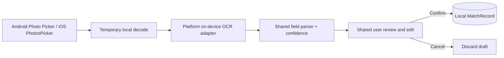

# Match screenshot import — Android + iOS research-stage design

**Not part of v0.0.** The optional v0.4 feature enables private, human-reviewed entry when an authoritative match-history feed is unavailable. `shared` owns parsing/field validation and MatchRecord semantics; platform pickers and OCR engine bindings are native.

Never automatically commit OCR results or upload user images. Examine platform OCR choices (e.g. Android ML Kit vs local OSS alternative, Apple Vision on iOS), licenses and F-Droid implications before implementation. No need for blanket gallery, camera or recording permission for this feature.

Different seasons, translations and screen layouts complicate extraction. Parse only visible evidence for map, legend, kills, assists, damage, placement, RP change and timing. Missing/uncertain fields remain editable blanks. If screenshot depicts a whole session, **do not** interpret it as one match. User confirmation is the only path from transient `ScreenshotDraft` to durable `MatchRecord`.

Use a local content hash and normalized fields to warn of possible duplicates, never silently discard. If OCR and remote RP intervals disagree, preserve both sources without overwriting user-confirmed or observed history. Delete temporary images on cancel and avoid storing incidentally recognized player names.

Before release, run a rights-cleared cross-platform sample corpus with documented per-field errors, cancel/duplicate/rotated image cases, accessibility and network-leak checks. Manual match entry remains a supported fallback.
