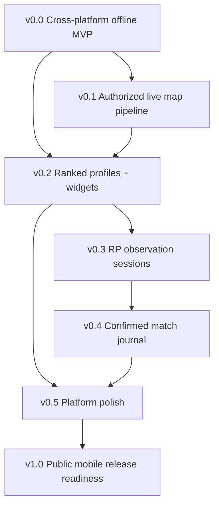

# Capability-led roadmap — Apex Companion

**Status:** v0.1 Maps, v0.2 Ranked/Profile and v0.3 private RP history/sessions/trends/backup are implemented for authorized private developer use. [v0.3 evidence](validation/v0.3-report.md) separates Android/shared validation from iOS source, which is Implemented — Not Verified under ADR0007. Public activation remains blocked. v0.2 supplies the missing minimum goal/settings foundations; v0.3 supplies the earlier missing backup/import; broader v0.0 navigation/settings and platform polish remain separate work.

## Dependencies

A separate **provider/legal/security gate** controls whether public network features may be enabled; failure does not stop offline software development. iOS source remains unverified until final stabilization under ADR 0007; deferred iOS evidence does not block intermediate versions. Native app distribution decisions are independent for Android and iOS.

## v0.0 — Working offline Android + iOS vertical slice

Use **KMP Wizard with Android + iOS shared Compose UI**, preserve its actual `androidApp`, `iosApp` and `shared` modules. Implement manual Ranked goal calculator, visibly DEMO map schedule, Today/Maps/Ranked/Settings/About screens and safe local persistence. Implement a native **map widget and Ranked goal widget** in Android Glance and iOS WidgetKit. Add platform file picker interfaces for versioned backup/restore, original themes and core automated tests.

**Exit:** Shared domain tests, Android install/UI/widgets, no forged live data, durable records/backup and no external key/EA assets. Implement feasible iOS source now; iOS runtime/signing/accessibility checks are deferred to final stabilization (ADR 0007). [Spec](specs/v0-0-offline-vertical-slice.md).

## v0.1 — Approved live map integration

Verify API rights and schema before implementing Ktor adapter; normalize segments and provenance, use coalesced cache and error backoff, feed native widgets on both platforms. Developer-only testing can precede public permission; public flag stays off until grant recorded.

**Exit:** validated fixtures, expired maps not shown LIVE on either OS, source attribution, 403/429 tests and public permission gate. [Spec](specs/v0-1-live-map.md).

## v0.2 — Ranked profile and RP

Link explicitly selected public profile (UID/platform), preserve offline goal, show rank/RP with freshness in shared UI + Android/iOS goal widgets. Optional Predator/server data only if provider-approved and contract-tested.

**Exit:** nullable fields and profile unlink tests, stale error UI, correct RP math and both native widget states. [Spec](specs/v0-2-ranked-goals.md).

## v0.3 — RP observation and sessions

Implemented opt-in timestamped RP evidence, user-confirmed context, valid same-split intervals, persistent manual session boundaries and trend views. **Never** convert net delta to a fictional match. Versioned cross-platform export and restore.

**Exit achieved for the intermediate milestone:** split reset/unknown/gap tests, persisted sessions across restart, Android/shared verification and feasible iOS source marked Implemented — Not Verified under ADR0007. [Spec](specs/v0-3-observations.md).

## v0.4 — Confirmed match import

Manual match journal and optional on-device OCR using native Android/iOS pickers and a reviewed local OCR engine/adapter. User confirms all parsed values before insertion. Map/legend aggregates use only confirmed records.

**Exit:** cancellation and duplicate tests, platform permission/privacy review and measured OCR quality. [Spec](specs/v0-4-match-import.md).

## v0.5 — Polished mobile companion

Original design and configurable native widget visuals, phone/tablet adaptive layouts, VoiceOver/TalkBack support, background budget testing, map-change notification opt-in and backup/migration QA.

**Exit:** visual and accessibility matrix on both platforms, privacy/performance evidence, no stale data masquerading as live. [Spec](specs/v0-5-polish.md).

## v1.0 — Independent open-source mobile releases

Android GitHub signed APK release and an explicitly selected compliant iOS distribution channel (Xcode source build/TestFlight/App Store, subject to Apple account/review). Android and iOS can be labelled distinct readiness states; do not claim a universal installable iOS IPA without correct signing and distribution.

**Exit:** security/legal/provider gates, real installs, native widget test evidence, release notes and truthful platform support. Offline-only public delivery is allowed. [Spec](specs/v1-0-release.md).

Further options (squad, Wear OS, event feeds, store, etc.) remain backlog research, not implicit v1.0 commitments. Pack/heirloom tracking is **explicitly out of scope** until a new product decision.
