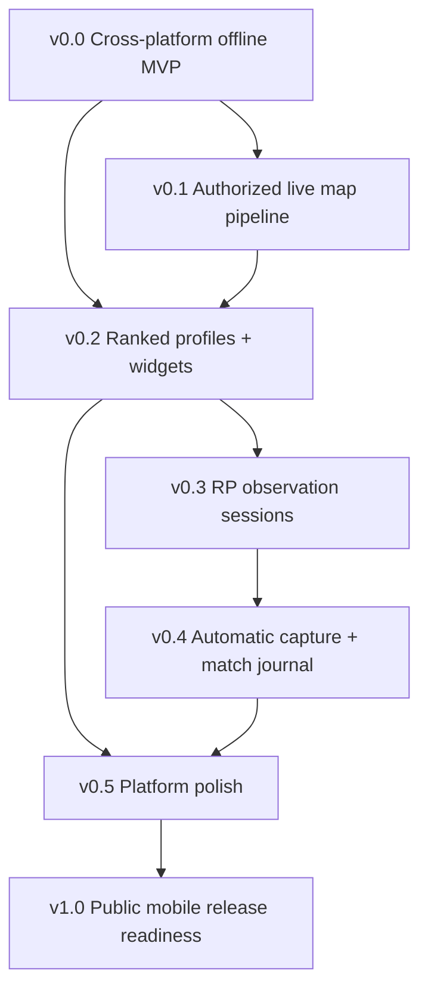

# Capability-led roadmap — Apex Companion

**Status:** v0.5 design/personalization is implemented locally with validation tracked in its report; v0.4 automatic capture remains unaccepted. v0.1 Maps, v0.2 Ranked/Profile and v0.3 private RP history/sessions/trends/backup are implemented for authorized private developer use. [v0.3 evidence](validation/v0.3-report.md) separates Android/shared validation from iOS source, which is Implemented — Not Verified under ADR0007. Public activation remains blocked. v0.2 supplies the missing minimum goal/settings foundations; v0.3 supplies the earlier missing backup/import; broader v0.0 navigation/settings and platform polish remain separate work.

## Dependencies

A separate **provider/legal/security gate** controls whether public network features may be enabled; failure does not stop offline software development. iOS source remains unverified until final stabilization under ADR 0007; deferred iOS evidence does not block intermediate versions. Native app distribution decisions are independent for Android and iOS.

## v0.0 — Working offline Android + iOS vertical slice

Use **KMP Wizard with Android + iOS shared Compose UI**, preserve its actual `androidApp`, `iosApp` and `shared` modules. Implement manual Ranked goal calculator, visibly DEMO map schedule, Today/Maps/Ranked/Settings/About screens and safe local persistence. Implement a native **map widget and Ranked goal widget** in Android Glance and iOS WidgetKit. Add platform file picker interfaces for versioned backup/restore, original themes and core automated tests.

**Exit:** Shared domain tests, Android install/UI/widgets, no forged live data, durable records/backup and no external key/EA assets. Implement feasible iOS source now; iOS runtime/signing/accessibility checks are deferred to final stabilization (ADR 0007). [Spec](specs/v0-0-offline-vertical-slice.md).

## v0.1 — Approved live map integration

Verify API rights and schema before implementing Ktor adapter; normalize segments and provenance, use coalesced cache and error backoff, feed native widgets on both platforms. Developer-only testing can precede public permission; public flag stays off until grant recorded.

**Exit:** validated fixtures, expired maps not shown LIVE on either OS, source attribution, 403/429 tests and public permission gate. [Spec](specs/v0-1-live-map.md).

## v0.2 — Ranked profile and RP

Link explicitly selected public profile (UID/platform), preserve offline goal, show rank/RP with freshness in shared UI + Android/iOS goal widgets. Optional Predator/server data only if provider-approved and contract-tested.

**Exit:** nullable fields and profile unlink tests, stale error UI, correct RP math and both native widget states. [Spec](specs/v0-2-ranked-goals.md).

## v0.3 — RP observation and sessions

Implemented opt-in timestamped RP evidence, user-confirmed context, valid same-split intervals, persistent manual session boundaries and trend views. **Never** convert net delta to a fictional match. Versioned cross-platform export and restore.

**Exit achieved for the intermediate milestone:** split reset/unknown/gap tests, persisted sessions across restart, Android/shared verification and feasible iOS source marked Implemented — Not Verified under ADR0007. [Spec](specs/v0-3-observations.md).

## v0.4 — Automatic match tracking and match history

Maintainer scope change adds an optional Windows selected-window capture companion, local OCR, explicit machine provenance and authenticated local phone sync alongside shared durable match journal, statistics and manual/screenshot fallbacks. [ADR0009](adr/0009-windows-match-capture.md) reconciles the former mobile-only scope; [ADR0010](adr/0010-match-journal-storage.md) preserves v0.3 data.

**In progress, primary automatic objective unfinished:** auto-acceptance is disabled until representative real Apex OCR/layout quality and actual Windows capture-to-phone behavior are demonstrated. Synthetic fixtures establish mechanics only. Native mobile screenshot picking/manual drafts do not claim implemented OCR. Android/shared evidence and exact remaining boundaries are recorded in the [v0.4 report](validation/v0.4-report.md). iOS source remains Implemented — Not Verified.

**Exit:** successive real matches collected without per-match entry, truthful provenance, no duplicates/overwrite, secure offline/reconnect sync, complete independent manual journal, measured recognition quality, Android/shared regression and explicit Windows/iOS statuses. [Spec](specs/v0-4-match-import.md).

## v0.5 — Four designs, personalization and reliability

Owner-expanded implementation: complete Carbon/Liquid/Editorial/Tactical presentation, durable Appearance Studio/presets, configurable Today, independent native widget design/accent/density/surface settings, responsive/accessibility fallbacks and gated favorite-map preferences. Existing semantics/storage/provider gates and unfinished v0.4 capture are preserved. [Spec](specs/v0-5-polish.md), [completed plan](../plans/completed/2026-11-03-v0-5-design-personalization.md).

**Exit:** actual Android/shared builds/tests, inspected four-style screen/widget matrix, restart/migration/accessibility/performance evidence and accurate limitations in [report](validation/v0.5-report.md). iOS source Implemented — Not Verified; Apple verification at final stabilization under ADR0007.

## v0.6 - Human-Directed Design Overhaul

**Planned, human approval gated.** The owner explicitly rejected the visual
quality and user experience of the v0.5 implementation despite completed
Android/shared functional validation. v0.6 will redesign navigation,
hierarchy, components, interactions, haptics and native widget presentation
screen-by-screen from the maintainer's approved references. Carbon, Liquid,
Editorial and Tactical remain available, but no theme/UX choice is made
autonomously by an LLM. Functional and privacy semantics are preserved.

Each screen requires explicit approval after implementation screenshots and
interaction evidence; technical tests alone do not imply visual acceptance.
Follow [v0.6 spec](specs/v0-6-design-overhaul.md),
[owner design brief](design/DESIGN_BRIEF.md) and
[active plan](../plans/active/2026-11-05-v0-6-human-directed-design.md).
v0.4 Windows Auto Capture remains separate unfinished work. iOS remains
Implemented - Not Verified until the final stabilization gate.

## v1.0 — Independent open-source mobile releases

Android GitHub signed APK release and an explicitly selected compliant iOS distribution channel (Xcode source build/TestFlight/App Store, subject to Apple account/review). Android and iOS can be labelled distinct readiness states; do not claim a universal installable iOS IPA without correct signing and distribution.

**Exit:** security/legal/provider gates, real installs, native widget test evidence, release notes and truthful platform support. Offline-only public delivery is allowed. [Spec](specs/v1-0-release.md).

Further options (squad, Wear OS, event feeds, store, etc.) remain backlog research, not implicit v1.0 commitments. Pack/heirloom tracking is **explicitly out of scope** until a new product decision.
