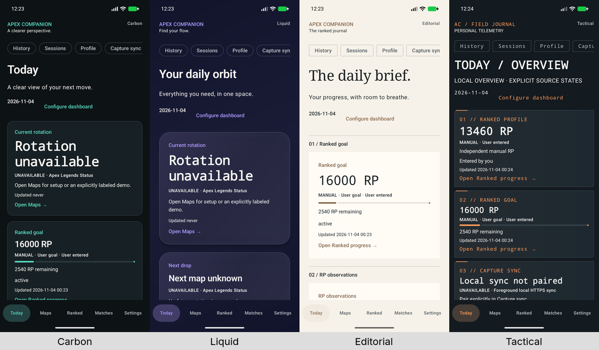

# v0.5 implementation and verification — 2026-11-03/04

Status: **COMPLETE for the authorized Android/shared intermediate milestone; iOS source Implemented — Not Verified.** Branch `feat/v0.5-polish`, starting commit `06daf6e`. Four designs and personalization are implemented and validated locally within the explicit platform boundaries below. No commit, tag, merge, push, publication or deployment performed. The separate v0.4 worktree was not altered.

## Delivered functionality

- Four centralized Carbon/Liquid/Editorial/Tactical themes with distinct typography, geometry, surface treatment, spacing, motion and dashboard defaults. All shared feature screens inherit resolved Material roles plus explicit themed cards.
- Dedicated Appearance Studio: real DEMO previews, apply/discard/previous/defaults, color/custom RGB/dynamic accent, light/dark/system/OLED, surface temperature, density/corners/cards/border, effects, text/numeric/motion settings and 24 local presets with create/rename/duplicate/delete/restore.
- Independent atomic 128 KiB appearance schema 1, safe defaults/missing-field migration, strict corruption/future handling, failed-commit retention and confirmed appearance-only recovery. Existing history/settings and match archives are unchanged; appearance export is not implemented.
- Real-data Today with 9 semantic modules, order/visibility/size/hide-unavailable/playlist controls and style-specific defaults. No inferred matches, fabricated maps or online statistics.
- Native Glance and source-only WidgetKit per-instance design/accent/density/surface, follow-app and sanitized cosmetic projection. No appearance-driven provider requests.
- Favorite-map preferences and deterministic UTC planning; delivery explicitly capability-gated while provider authorization/reliable future scheduling is unresolved. No notification permission/scheduler/polling activated.

## Platform boundary

Android/shared validation below is executed on Linux. iOS source is **Implemented — Not Verified** under ADR0007; no Xcode, Swift compilation, Kotlin/Native build, simulator, signing or Apple tooling executed. Native Liquid Glass is not claimed. Liquid uses bounded drawing with solid fallbacks. Public providers remain gated. v0.4 production acceptance registry remains empty; real Windows/Apex capture and mobile OCR are still unfinished.

## Executed validation

The final non-device command completed with exit0:

```sh
./gradlew :androidApp:assembleDebug :androidApp:assembleRelease :androidApp:assembleDebugAndroidTest :shared:testAndroidHostTest :androidApp:testDebugUnitTest :androidApp:lintDebug :androidApp:lintRelease --console=plain
```

[Exact command/timing](v0.5-logs/history-hit-area-build.meta.json), [output](v0.5-logs/history-hit-area-build.log): BUILD SUCCESSFUL, 25.700 seconds wall, 179 tasks (34 executed, 145 up-to-date). Shared XML has 248 tests, 246 passed, 2 opt-in live skips, 0 failures/errors; the final source build executed the shared host suite after the history hit-area change. Android app unit task is **NO-SOURCE**, not a passed suite. Debug lint has 0 errors/39 warnings; release lint0 errors/41 warnings. Warnings include existing dependency/toolchain notices, unused attributes, trust/persistence patterns, native-editor i18n/UseKtx and release monochrome icons; no blanket suppression or dependency upgrade was introduced.

Focused native final check passed 2 tests, 35.195 seconds runner/35.883 seconds wall:120 render matrix with measured glyph/ellipsis checks and actual widget destination/recreation. [Exact command](v0.5-logs/native-and-route-final.meta.json), [output](v0.5-logs/native-and-route-final.log). The final complete connected command passed with exit0 and 881.667 seconds wall time:

```sh
./gradlew :androidApp:connectedDebugAndroidTest -Pandroid.testInstrumentationRunnerArguments.v05Variant=regression --console=plain
```

43 cases: **42 passed, 1 skipped, 0 failures/errors**. Only the opt-in private provider live check was skipped; the pinned-TLS Linux mock check executed and passed. [Exact command/timing](v0.5-logs/final-connected-accepted.meta.json), [output](v0.5-logs/final-connected-accepted.log), [machine evidence](v0.5-evidence.json). Repeated focused tests are not added to these totals.

Earlier diagnostics are retained separately: the interrupted run, two repaired UI-harness assertions, and a complete 43-case run with one history-switch hit-area failure. The original history test then passed unchanged after the 48 dp full-row Switch repair (204.361 seconds runner/205.167 seconds wall); the final whole suite above passed afterward. [Focused evidence](v0.5-logs/history-hit-area-focused.meta.json). Failed/interrupted runs are not acceptance evidence.

Task discovery: broad `./gradlew tasks --all --console=plain` is limited by a generated release Compose Preview unit-test task while release unit tests are disabled. Narrow `./gradlew help --task :androidApp:connectedDebugAndroidTest --console=plain` succeeded, and the explicitly invoked build/test/lint tasks executed as recorded. [Source manifest](v0.5-source-manifest.json) identifies the implementation under final connected validation.

Documentation and whitespace gates: `python3 tools/check_docs.py` verifies 91 Markdown documents/14 local skills, and `git diff --check` verifies tracked diff whitespace. Exact final outputs are [docs](v0.5-logs/final-docs.meta.json) and [diff](v0.5-logs/final-diff.meta.json). Moving the completed plan required repairing its remaining index link. [Cleanup evidence](v0.5-cleanup.json) records restored task-fixture state, stopped task mock and verified display/font/reader settings.

## Four functional visual identities



This overview resizes four actual Android screenshots; [source hashes](v0.5-design-overview.json) identify the full captures. It is not concept art.

| Design | Actual differences | Actual Android screen captures |
|---|---|---|
| Carbon | Graphite/teal, measured outlined surfaces, 16 dp default geometry, sans hierarchy, monospace numeric emphasis, comfortable map-led Today, 150 ms motion | [Today](v0.5-captures/v05-carbon-phone-today.png), [Maps](v0.5-captures/v05-carbon-phone-maps-demo.png), [Ranked](v0.5-captures/v05-carbon-phone-ranked.png), [journal](v0.5-captures/v05-carbon-phone-matches.png), [detail](v0.5-captures/v05-carbon-phone-match-detail.png), [statistics](v0.5-captures/v05-carbon-phone-match-statistics.png), [Studio](v0.5-captures/v05-carbon-phone-studio.png) |
| Liquid | Violet layered gradients, bounded 70–100% surface alpha on a local opaque backdrop, 30 dp corners, raised surfaces, spacious floating modules, finite spring/control and 300 ms progress | [Today](v0.5-captures/v05-liquid-phone-today.png), [Maps](v0.5-captures/v05-liquid-phone-maps-demo.png), [Ranked](v0.5-captures/v05-liquid-phone-ranked.png), [journal](v0.5-captures/v05-liquid-phone-matches.png), [detail](v0.5-captures/v05-liquid-phone-match-detail.png), [statistics](v0.5-captures/v05-liquid-phone-match-statistics.png), [Studio](v0.5-captures/v05-liquid-phone-studio.png) |
| Editorial | Warm light selection and dark alternative, system serif headings, 3 dp flat publication surfaces, fine numbered rules, one-column narrative goal-led Today, 220 ms motion | [Today](v0.5-captures/v05-editorial-phone-today.png), [Maps](v0.5-captures/v05-editorial-phone-maps-demo.png), [Ranked](v0.5-captures/v05-editorial-phone-ranked.png), [journal](v0.5-captures/v05-editorial-phone-matches.png), [detail](v0.5-captures/v05-editorial-phone-match-detail.png), [statistics](v0.5-captures/v05-editorial-phone-match-statistics.png), [Studio](v0.5-captures/v05-editorial-phone-studio.png) |
| Tactical | Steel/orange, system monospace instrumentation, 5 dp cut corners, accent rules, compact ranked/capture-led telemetry and wide two-column layout, 100 ms motion | [Today](v0.5-captures/v05-tactical-phone-today.png), [Maps](v0.5-captures/v05-tactical-phone-maps-demo.png), [Ranked](v0.5-captures/v05-tactical-phone-ranked.png), [journal](v0.5-captures/v05-tactical-phone-matches.png), [detail](v0.5-captures/v05-tactical-phone-match-detail.png), [statistics](v0.5-captures/v05-tactical-phone-match-statistics.png), [Studio](v0.5-captures/v05-tactical-phone-studio.png) |

These are actual emulator captures of the shared implementation with isolated local fixtures, not concept artwork or current player/game data. Source labels remain DEMO/MANUAL/UNAVAILABLE. The gallery previews use the real theme/card/progress components. No unavailable four-concept reference images were claimed inspected.

## Persistence, presets and dashboard

`AppearanceModels.kt`, `AppearanceCodec.kt`, `AppearanceRepository.kt` separate cosmetic schema 1 from game repositories.24 presets and 131072 bytes maximum; bounded depth, explicit keys/types/enums/ranges; absent schema 1 fields default safely. Corrupt/future/invalidUTF8 bytes remain read-only until confirmed appearance reset. Android uses actual AtomicFile, iOS source uses protected Foundation atomic writes. Failed writes keep previous published/durable settings. Existing history/settings and match archives are not migrated or changed. Actual Android tests cover interruption/reopen/corruption/preset CRUD and activity recreation. [Two actual cold-process launches](v0.5-restart-evidence.json) retained synthetic Tactical appearance/dashboard; original cosmetic bytes were restored and the app relaunched. The restart script did not inspect or mutate game files; normal app initialization still runs.

Studio supports preview/apply/discard/previous/defaults; safe custom six-digit RGB or palettes; Android dynamic accent when available; light/dark/system/OLED; surface temperature; density/corners/cards/borders; Liquid opacity/gradient; reduced effects/transparency/high contrast;85–130% additional text size retaining OS scale; numeric emphasis and Full/Reduced/Off motion. Presets save applied appearance plus optional dashboard, with create/rename/duplicate/delete/restore. They are local; appearance export/import is not shipped.

Today uses one semantic projection of existing maps/ranked/history/matches/sync. Its9modules support visibility, accessible up/down order, compact/standard/expanded size, hiding unavailable values and an independent map playlist. Style defaults differ. Custom arrangements survive style changes; reset is explicit. RP charts connect compatible observations only and do not invent matches. Future-dated latest activity and foreign identities are excluded; unknown remains unknown. Android UI exercises visibility/size/order/reset and durable local preferences.

All existing shared destinations inherit resolved colors/typography/geometry/motion: Today, Maps, Ranked/goals/Predator, Profile, History/trends, Sessions, Matches/manual/detail/statistics/backups, Capture sync/pairing, Settings/private import-export, Studio, notification preferences and About. Journal filters are collapsible; result/aggregate cards use explicit variants. Raw IDs/parser/revisions are available under Evidence details, expanded initially for review-required records. Source/quality/timestamp information remains visible. [Hardware keyboard evidence](v0.5-keyboard-evidence.json) records real TAB/ENTER/BACK injection through Settings → Studio → Settings, with no touch/accessibility click actions; this is a keyboard smoke test, not a complete keyboard usability audit.

## Native widgets and notification capability

Glance retains native map/progress/goal/Predator rendering and service-backed per-instance preferences. Look opens a private editor with design/accent/density/surface, DEMO preview, Apply/Cancel and recreation-safe draft. WidgetKit source uses independent AppIntent parameters and sanitized App Group appearance. Follow-app is optional; independent design settings never overwrite another instance. Shared strict cosmetic wire is schema 1, 2048 bytes maximum, with only style/accent/dark/density/OLED. Publication/read are serialized; atomic commit precedes local reloads. No widget fetches a provider on appearance changes. Existing source projections/timeline validity rules are preserved.

Native widget evidence uses120 actual Glance RemoteViews rendered on the emulator at 150×150, 250×180 and 300×220 dp plus actual AppWidgetHost-bound instance/editor checks. It is not physical/OEM launcher or WidgetKit runtime evidence. Liquid uses a solid layered Android fallback and source-only static SwiftUI gradient; no blur/live animation/per-second update claim. Per-instance independence and source/time labels are mandatory at small sizes. All 120final renders were viewed in ten family contact sheets, with standalone inspection of critical spacious/detail and long-map small cases. Their SHA-bound [inspection ledger](v0.5-widget-inspection.json) and [geometry checks](v0.5-widget-geometry.json) record no remaining findings in the tested font scale 1.0 matrix. The medium family uses compact layout based on height; optional decoration and next-map rows yield before critical data. Expanded goal status shares a progress row. Widget app intents open Maps/Ranked and reject other routes; SwiftUI forwards existing WidgetKit URLs through the same allowlist, source-only. Large native widget fonts and physical launcher interaction remain unvalidated.

Favorite-map delivery is **disabled** on both targets until authorized trustworthy future data exists. Local advance/favorite preferences and strict UTC planning are implemented; DEMO/expired/future-fetched/retained data, duplicate IDs and opt-out yield no alerts. No OS scheduling, notification permission request or new polling is activated. Native delivery/cancellation/authorization adapters remain a future capability before enabling the gate; no successful notification delivery is claimed.

## Accessibility and responsive inspection

App foreground/control contrast is resolved against actual card/page gradient composites. System font scale is multiplied once, including nested previews. High contrast/power/reduced effects remove decoration; reduced transparency forces opaque surfaces/removes gradients. OS reduced motion/power override preferences; app progress and Material controls use finite motion specs. Material semantics, explicit source text, selected navigation labels and named ordering actions remain available to TalkBack/VoiceOver source.

Actual bound TalkBack test passed across all 4 styles:8 named navigation focus actions and 4 MANUAL source focus actions. It restores original accessibility services, enabled state and reader notification permission/decision flags. [Evidence](v0.5-talkback-evidence.json). Spoken wording/full human screen-reader usability is **not audited**; VoiceOver is unverified. Physical/OEM layouts and the full release accessibility matrix remain final-stabilization work.

Actual responsive matrix covers standard phone, 320dpcompact, 1280dpexpanded Liquid, 200% system-text Editorial light, Editorial dark and Tactical landscape. Large text changes primary navigation to 3+2 rows; safe drawing insets retain cutout/status/navigation safety while avoiding unnecessary side-gesture margins. Core forms wrap/scroll; wide Today adapts columns. All 81 final app captures (9 pages × 9 style/device variants) have been inspected and are bound to individual SHA256 hashes in the [app ledger](v0.5-qa-inspection.json).

## Visual defects found and repaired

The history-recording row now has one Switch role and a minimum 48 dp full-row hit area; the original persistence callback and opt-in rules are preserved. Actual Android inspection found black ambient body text on dark transparent surfaces; explicit onSurface content color fixes it. Primary navigation clipped horizontally and broke words on compact/large-text layouts; equal-width controls, safe drawing insets and adaptive 3+2 rows fix it. Small native widget placeholders/footer labels were shortened while retaining source/time. Liquid gradient compositing could reduce contrast; resolution now checks actual composited stops, with real bounded alpha and opaque fallbacks. Selected chips now resolve theme roles instead of stock purple. Plain match diagnostics and filter-heavy lists were replaced with themed result/summary cards, expandable evidence and collapsible filters. Failed pre-fix images/logs are separate and are never acceptance evidence.

## Performance observations

[Machine-readable raw counters and context](v0.5-performance.json) preserve9 actual emulator gfxinfo observations. Phone navigation/scroll/capture counters were:

| Style | Frames | Reported jank | p95 | p99 |
|---|---:|---:|---:|---:|
| Carbon |309|12.94%|53ms|113ms|
| Liquid |606|22.28%|57ms|101ms|
| Editorial |371|7.01%|44ms|117ms|
| Tactical |426|19.72%|61ms|117ms|

These are unsynchronized SwiftShader workloads including screenshots/test waits, not a causal theme-cost comparison, steady-state idle measurement or physical-device benchmark. GPU4950 ms histogram buckets are retained without treating them as physical latency. No FPS, CPU, RAM, battery or energy figures are inferred. Interrupted large-text timing is explicitly null/uncertain where unavailable.

Reviewed effects are bounded static three-stop brushes, local opaque-backdrop alpha70–100%, maximum6 dp elevation and finite spring/tween controls/progress. OS motion/power/contrast/transparency overrides remove applicable effects. No full-screen blur, shader, backdrop readback or infinite decorative animation is introduced. Existing foreground map ticks and 30 second foreground synchronization remain semantic lifecycle work. Raw observations predate the final widget-navigation and test additions; no widget performance claim is derived from them.

## Privacy, regression and limitations

The [bounded local audit](v0.5-privacy-audit.json) found no known mock/developer credential or private-key block in source/APK contents, no new Android permissions, no dependency-catalog change and unchanged production capture acceptance policy. Release APK contains no private developer-key reader. This is a known-value scan, not proof about arbitrary unknown secrets or Apple binaries. Original system fonts and code-drawn artwork add no proprietary font/art dependencies. Cosmetic state is private; native App Group receives sanitized projections only; no private history/credential data enters appearance wire. No appearance-driven provider requests are introduced.

v0.4 regression includes existing host semantics, Android persistence/document/screens/widgets and local pinned-TLS Linux mock behavior. This never establishes real Windows capture or Apex OCR accuracy. The production layout registry stays empty. Physical/OEM Android, high-font native widgets, full spoken TalkBack usability, Apple/VoiceOver runtime, provider release authorization and actual notification delivery remain before-v1.0 qualification gates.

## Acceptance decision

All 12 criteria are met for this authorized intermediate milestone. This does not qualify physical Android, Apple binaries or public online release. The detailed [machine decision](v0.5-acceptance.json) retains platform limitations.

| ID | Decision and evidence |
|---|---|
| V05-01 | MET: four resolved identities, all shared destinations/components,81 inspected app captures and existing-feature UI regression |
| V05-02 | MET: real Studio/preset actions, preview/apply/reset and draft/dialog recreation tests |
| V05-03 | MET: bounded strict codec, real AtomicFile failure/reopen/corrupt tests and2 actual cold launches; independent cosmetic file |
| V05-04 | MET: semantic Today projections, durable show/order/size/playlist/hide-unavailable and native controls/reset |
| V05-05 | MET within native constraints:120 inspected Glance renders/3 families, bound-instance/editor/concurrency tests, no provider requests; WidgetKit source unverified |
| V05-06 | MET:201 SHA-bound inspected captures:81 app +120 native, including compact/expanded/large-text/light/dark/landscape/offline states |
| V05-07 | MET within reported scope: contrast/override tests, shared semantics,48 dp row control, bound TalkBack focus and actual hardware-key navigation; spoken/VoiceOver/native large-font audits deferred |
| V05-08 | MET:248 shared/43 connected cases with explicit 3 live skips, debug/release/test builds, lint 0 errors, docs and diff checks; app unit NO-SOURCE |
| V05-09 | MET within bounded audit: unchanged game backup schemas/provider rights/capture policy/dependency catalog, no new permission or known-secret hit; no appearance-driven provider calls |
| V05-10 | MET using owner-authorized disabled capability: local preferences/UTC policy tested; no notification delivery or scheduling claimed |
| V05-11 | MET for source delivery: shared Compose, native protected storage/App Group/WidgetKit/URL adapters; Implemented — Not Verified, no Apple tooling |
| V05-12 | MET: this report, exact command metadata, source/inspection/artifact evidence, raw performance observations and remaining qualification gates |

## Changed implementation files

- Shared: new `appearance/` models/codec/repository/theme/Studio/dashboard/notification policy/widget wire, plus `WidgetNavigation.kt`; integrated `App.kt` and themed History/Ranked/Match screens. Shared tests live in `commonTest/.../appearance/`.
- Android: `MainActivity.kt`, `platform/AndroidAppearanceRuntime.kt`, OS environment adapter, native widget renderers plus `WidgetAppearance.kt`/`WidgetAppearanceActivity.kt`, one private manifest activity and version/test-resource configuration. Added AtomicFile, UI/keyboard, bound-reader and native widget instrumentation.
- iOS source: appearance environment/MainViewController bridge, protected `RotationStorage.swift`, SwiftUI URL forwarding in `ContentView.swift`, WidgetKit appearance/AppIntent/renderers and version configuration. Existing Wizard project/module layout is preserved.
- Documentation/evidence: ADR0011, version spec, design/customization/widget guides, required product/architecture/roadmap/privacy/testing docs, completed plan, capture/inspection/command JSON and local collection/audit scripts. No companion algorithm, existing game schema or dependency-catalog change.

## Documentation and before v1.0

Updated README/CHANGELOG, architecture/ADR0011, requirements/roadmap/feature matrix/privacy/testing, v0.5 spec, [design](../DESIGN_SYSTEM.md), [customization](../APPEARANCE_CUSTOMIZATION.md), [widgets](../WIDGET_THEMING.md) and [completed plan](../../plans/completed/2026-11-03-v0-5-design-personalization.md). Full Apple validation, physical Android/OEM launcher tests, provider/public release rights, actual notification delivery eligibility and separate real Windows capture acceptance remain pre-release gates.
